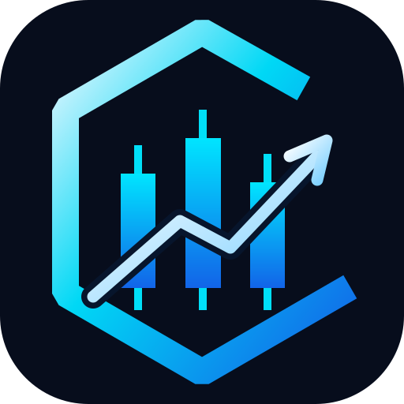

# CRYPTANOMICS

<p align="center">
  <strong>A market simulator. A zero-balance start. A career built from the first trade.</strong>
</p>

<p align="center">
  <a href="https://github.com/ItzUnik1/Cryptanomics-/actions/workflows/android-apk.yml"></a>
  <a href="https://github.com/ItzUnik1/Cryptanomics-/releases"></a>
  
  
</p>

CRYPTANOMICS is a mobile-first, real-inspired **cryptocurrency trading simulation**. Build a trading career in a fictional market: research assets, follow market events, manage risk and grow a portfolio from nothing.

> **Simulation only.** CRYPTANOMICS does not connect to cryptocurrency exchanges, process real transactions or use real money. All assets, prices and market events are fictional.



## Download

Get the latest Android APK from the [GitHub Releases page](https://github.com/ItzUnik1/Cryptanomics-/releases/latest).

The app checks GitHub Releases for newer versions from its main menu. Android still requires the user to confirm installation through the system installer.

## Current features

- **Zero-balance career:** begin with $0, no holdings, no business and no debt.
- **Earn starting capital:** complete research and freelance contracts to earn simulated funds.
- **Fictional market:** 15 fictional digital assets with individual volatility and price histories.
- **Trading terminal:** buy and sell with balance checks, quantity validation and a 0.15% fee.
- **Portfolio tracking:** monitor cash, holdings, equity, average entry and unrealised profit/loss.
- **Market simulation:** advance the simulation day, pause or resume the market clock.
- **Market news:** simulated headlines and events influence market conditions.
- **Activity history:** review completed trades and fees.
- **Currency display:** switch between USD and NPR. NPR uses a fixed in-game display conversion of रू 140 per USD, not a live exchange rate.
- **Local saves:** career data is stored on the device.
- **Update checker:** check for newer published APK releases from the main menu.
- **App identity:** custom CRYPTANOMICS launcher icon and consistent release signing.

## Tech stack

| Layer | Technology |
| --- | --- |
| Interface | HTML, CSS, JavaScript |
| Web build | Vite |
| Android wrapper | Capacitor 7 |
| Android build | Gradle |
| Automation | GitHub Actions |

## Run the web version locally

Requirements: Node.js 22 or newer and npm.

```bash
git clone https://github.com/ItzUnik1/Cryptanomics-.git
cd Cryptanomics-
npm install
npm run dev
```

Create a production web build:

```bash
npm run build
```

The generated web app is written to `dist/`.

## Build the Android APK

The Capacitor Android project is kept in this repository so the native build configuration and Gradle wrapper are version-controlled. Release APKs use a persistent signing key stored in the private GitHub Actions secret `ANDROID_SIGNING_CONFIG`.

Requirements: Node.js 22+, npm and JDK 21.

```bash
npm install
npm run android:build
```

The debug APK is generated at:

```
android/app/build/outputs/apk/debug/app-debug.apk
```

You can also open the native project in Android Studio:

```bash
npx cap sync android
npx cap open android
```

For a clean setup where the Android folder has not yet been generated:

```bash
npm install
npm run build
npx cap add android
npx cap sync android
```

See [BUILDING.md](BUILDING.md) for the full build and release process, including the one-time signing secret setup.

## Repository layout

```
.
├── .github/
│   └── workflows/
│       └── android-apk.yml
├── android/                 # Capacitor Android project and Gradle files
├── src/
│   ├── data.js              # Fictional assets and market news
│   ├── engine.js            # Simulation and trading logic
│   ├── main.js              # Application interface and navigation
│   ├── storage.js           # Local career saves
│   └── style.css            # Responsive interface styling
├── capacitor.config.json
├── index.html
├── package.json
└── BUILDING.md
```

## Releases and versioning

The app version is defined in `package.json` and mirrored in `src/main.js` for the in-app update checker. Keep these versions in sync when preparing a release.

Pushing application changes to `main`, or manually starting the workflow, runs the Android build. The workflow uploads the APK as a GitHub Actions artifact and publishes a versioned GitHub Release.

## Project status

CRYPTANOMICS is under active development. The current repository represents **Phase 1**: a functioning single-player trading simulation and Android package. Future phases can expand the market model, progression, events and long-term career systems without requiring real-money services.

## Safety and privacy

- No real cryptocurrency, exchange account or wallet is required.
- No real-money deposits, withdrawals or trading are supported.
- Career saves are stored locally on the device.
- Market prices, news and currency conversion are simulated.
